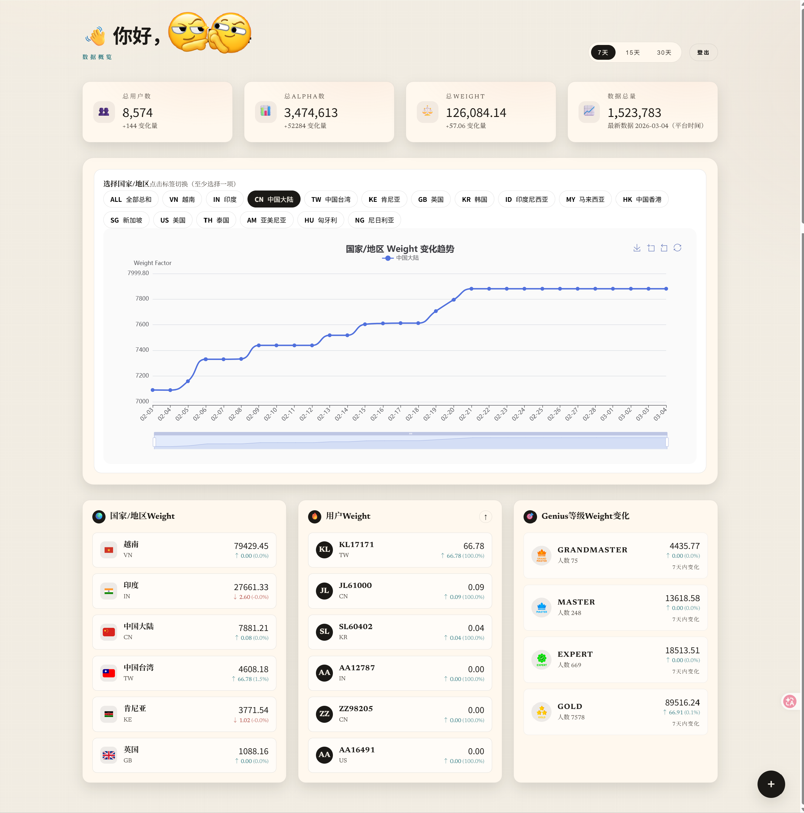
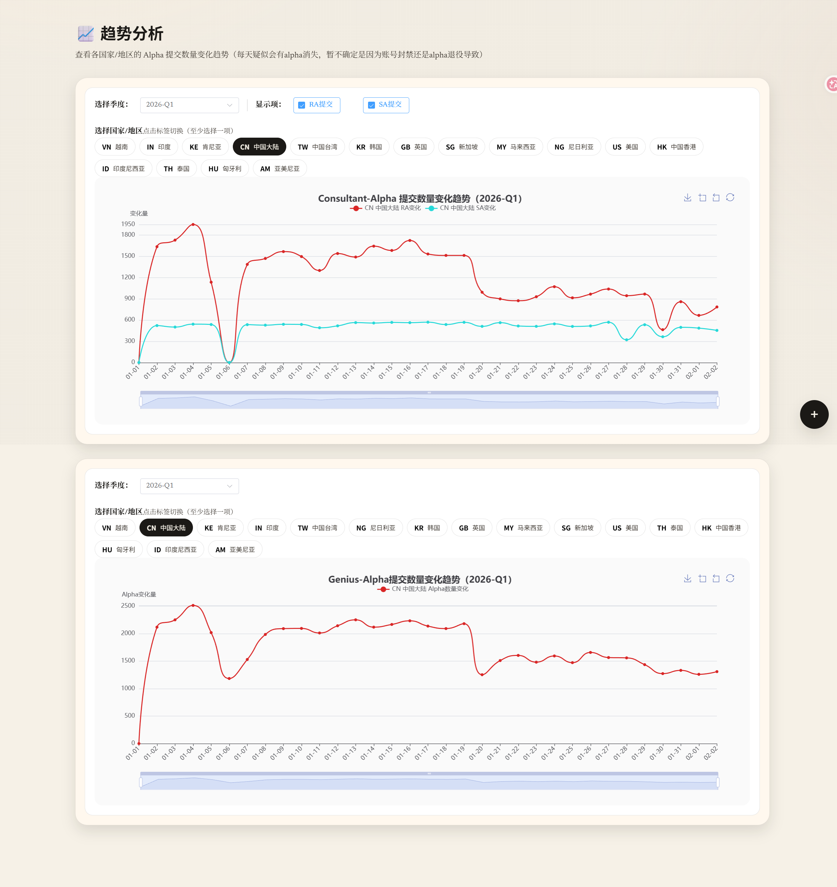
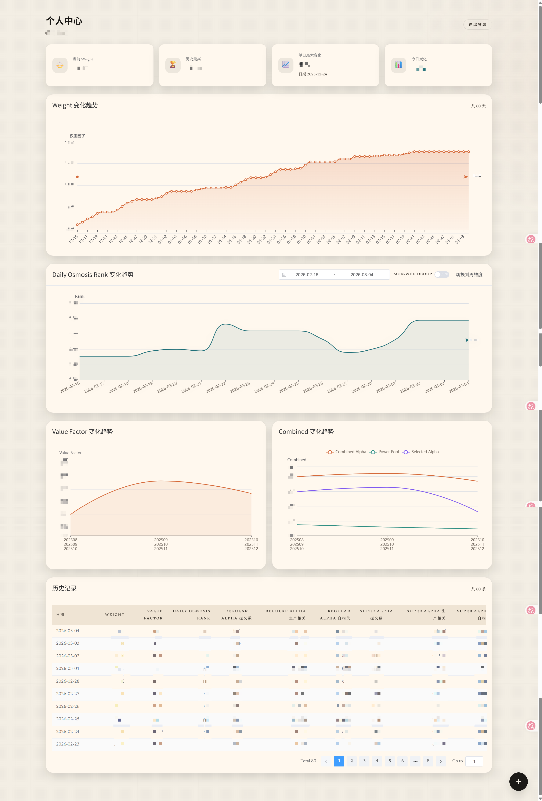
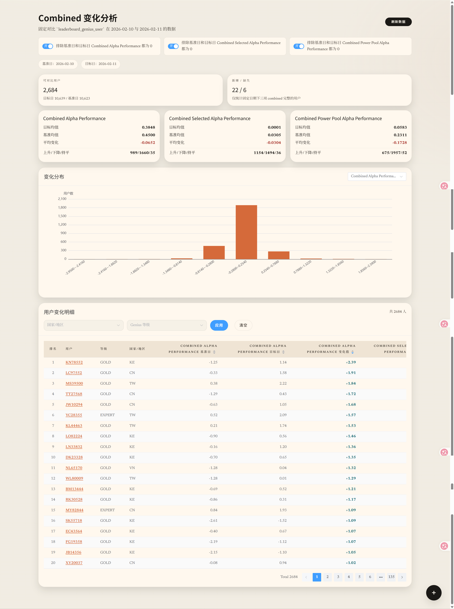
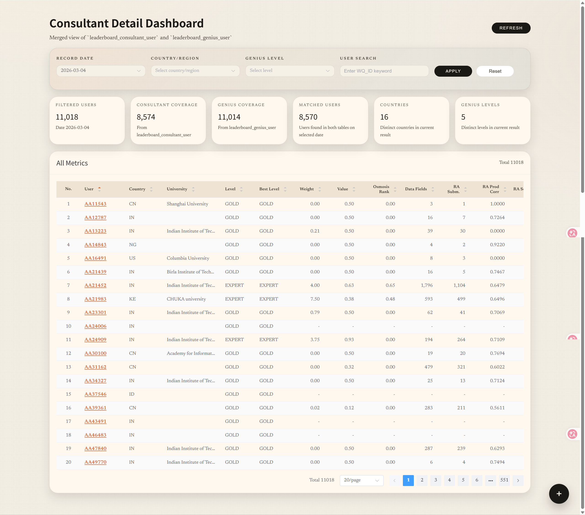
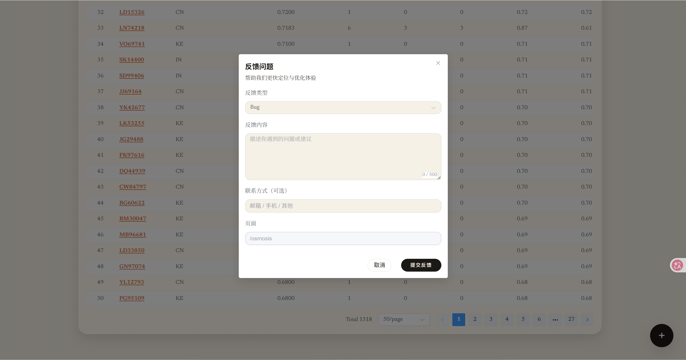

# WQ Manager Backend

基于 FastAPI 的后端服务，提供榜单、趋势、个人中心、Genius 仪表盘、反馈等 API。

在线体验：https://wqmanager.qzz.io/

## 技术栈

- FastAPI / Uvicorn
- SQLAlchemy (Async)
- MySQL
- Redis（可选缓存）

## 本地运行

```bash
python -m venv venv
venv\Scripts\activate       # Windows
# source venv/bin/activate  # Linux/Mac

pip install -r requirements.txt
uvicorn main:app --reload --host 0.0.0.0 --port 8000
```

访问：
- Health: http://localhost:8000/health
- Swagger: http://localhost:8000/docs

## Docker 构建与启动

在 `backend/` 目录执行：

```bash
docker build -t wq-backend .
docker run -d --name wq-backend --env-file .env -p 8000:8000 wq-backend
```

## 环境变量

复制模板并修改：

```bash
cp .env.example .env
```

关键配置项：

```
PROJECT_NAME=WQ Manager API
VERSION=1.0.0
API_PREFIX=/api/v1
SECRET_KEY=change-me
ACCESS_TOKEN_EXPIRE_MINUTES=10080
ALGORITHM=HS256

ALLOWED_ORIGINS=["http://localhost:5173","http://127.0.0.1:5173"]

DATABASE_URL=mysql+pymysql://DB_USER:DB_PASSWORD@DB_HOST:3306/DB_NAME
DEBUG=True

LOG_LEVEL=INFO
SQL_ECHO=False
SQL_ECHO_POOL=False
LOG_DIR=logs

REDIS_URL=
CACHE_EXPIRE_HOUR=14
CACHE_EXPIRE_MINUTE=0
CACHE_TIMEZONE=Asia/Shanghai

MINIO_ENDPOINT=http://your-minio-host:9000
MINIO_ACCESS_KEY=your-access-key
MINIO_SECRET_KEY=your-secret-key
MINIO_BUCKET=wqmanager
MINIO_SECURE=False
MINIO_PUBLIC_BASE_URL=http://your-minio-host:9000
```

> `REDIS_URL` 为空时缓存自动关闭。
> Base Payment 图片上传会写入 MinIO，并在 `base_payment.picture` 中以 JSON 数组格式存储可访问 URL 列表。
> `MINIO_ENDPOINT` 应填写 S3 API 地址（通常为 9000 端口），不是管理控制台地址（通常为 9001 端口）。`MINIO_ACCESS_KEY` 和 `MINIO_SECRET_KEY` 必须属于当前 MinIO 服务。`MINIO_PUBLIC_BASE_URL` 用于浏览器读取图片，HTTPS 网站应使用对应的 HTTPS 图片域名或反向代理地址。

## 缓存策略

后端使用 **cache-aside**，统一缓存装饰器位于 `app/core/cache.py`：
- 自动根据请求路径 + query 生成缓存 key
- 默认 TTL 到达每日指定时间（默认 14:00，Asia/Shanghai）
- 登录相关接口不启用缓存

## 赞助记录维护

请先手动执行 `migrations/20260905_create_sponsor_donation.sql` 创建 `sponsor_donation` 表。每次赞助单独保存一条记录，`id` 为自增主键，`wq_id` 允许重复；前端接口按赞助记录逐条返回 `wq_id`，同一人多次赞助会返回多次，但不会返回金额。后端启动时不会自动创建或修改该表。

新增赞助记录：

```sql
INSERT INTO sponsor_donation (wq_id, amount)
VALUES ('YOUR_WQ_ID', 10.00);
```

删除赞助记录：

```sql
DELETE FROM sponsor_donation WHERE id = 1;
```

## Submit请等等

Alpha 图文评审社区，接口前缀为 `/api/v1/submit-wait`，全部接口使用现有 JWT 登录认证。

首次部署前，在 WQ Manager 的 MySQL 数据库中依次执行 `migrations/20261015_create_submit_wait.sql` 和 `migrations/20261015_add_submit_wait_watch.sql`，共新增 7 张表。已有基础表的部署只需执行第二份脚本，增加围观记录表；后端启动不会自动建表。图片沿用现有 MinIO API 地址、访问密钥与桶配置，使用独立的 `submit-wait/` 对象前缀；私有桶图片通过后端授权读取。Nginx 的请求体上限须至少覆盖 9 张 10MB 图片，仓库中的配置已设为 `100m`。

自定义表情还需执行 `migrations/20261015_add_submit_wait_stickers.sql`，增加表情库和评审表情关联两张表（完整功能共 9 张表），再运行 `python scripts/seed_submit_wait_stickers.py`。导入脚本读取 `assets/submit-wait/stickers/catalog.json` 和原图，将内容哈希命名的图片上传到现有私有 MinIO，并更新表情库；重复运行不会增加同一图片的记录。源文件仅用于部署导入，运行时不使用本地图片存储或备用存储。

`GET /stickers` 返回登录用户可选的表情；评审 `POST /posts/{id}/votes` 可附加 `sticker_ids`（默认空，最多 3 个、不重复、仅限已启用表情），文字理由仍必填。意见列表批量返回表情与专用一小时图片凭证，沿用评审/围观可见权限；图片凭证不能作为登录凭证，读取时检查用户状态。停用表情不影响历史意见展示，但无法用于新评审。

功能和规则：

- 发布标题、文字说明及最多 9 张 PNG / JPEG / GIF / WebP 图片，每张最多 10MB。文字必填，图片可选；默认匿名，也可展示用户名。
- 公开广场面向所有登录用户；好友小组仅限成员访问，通过随机邀请码加入。
- 他人选择“建议提交”或“暂缓提交”，必须写理由；不能自评，每人每份申请只评审一次。
- 前端将两种选择展示为「交！它已经绿了！」和「管住手哇！」，接口的 `submit` / `hold` 枚举保持一致。
- `GET /posts/random` 从当前公开广场或指定小组的全部候选中随机抽取可评审的申请，支持 `group_id`、`blocked` 与 `exclude_id`。排除自己的、已评审、已围观、已关闭与已撤回的申请，小组仍校验成员身份；没有候选返回 `null`。有其他候选时排除上次抽到的 ID，仅剩一份时允许再次抽中。此接口不创建评审或围观记录，也不提前解锁意见。
- 作者始终可以查看意见；其他用户在评审或围观之前，API 不返回分项票数或评审理由。围观解锁意见，并永久禁止该用户评审这条申请；已结束的申请也可围观。围观重复请求不增加人数，作者和已评审者无需围观。
- 广场按已评人数降序，人数相同按发布时间及 ID 降序；排序发生在分页前。个人列表按最新发布排序。围观人数与已评人数独立统计，不计入评审统计或热度。
- 可以给有帮助的理由送花；支持搜索、分页、状态筛选、我的申请、我已评审、我在围观及浏览器本地屏蔽词。
- 作者可记录“已经提交”或“继续打磨”并结束评审，也可撤回申请。此操作只记录作者反馈，不会调用 WorldQuant 提交接口。
- 图片 ID 校验上传者和使用状态；匿名图片路径不包含 WQ ID 或原始文件名。撤回采用软删除，已上传对象不会自动从 MinIO 删除。
- Submit请等等 的图片通过本应用 `/api/v1/submit-wait/images/{id}` 授权读取，兼容私有 MinIO 桶和 HTTPS 页面，无须开放桶的匿名访问权限。图片链接包含一小时有效的专用凭证，读取时仍检查用户状态和申请访问权限；凭证不能用作登录令牌。刷新申请可获取新链接。其他模块继续沿用 `MINIO_PUBLIC_BASE_URL` 配置。

验证：安装 `requirements-dev.txt` 后运行 `python -m unittest tests.test_submit_wait -v`。测试使用独立的内存 SQLite，不连接业务数据库；MinIO 外部调用由测试替身覆盖。MySQL 的行锁与唯一约束用于处理并发评审/围观、图片绑定和加入小组，SQLite 测试不覆盖 MySQL 并发行为。

本地开发统一运行 `uvicorn main:app --reload --host 127.0.0.1 --port 8000`，读取 `backend/.env` 中的 MySQL、Redis 和 MinIO 配置，再启动前端。登录使用数据库中已注册且已激活的真实 WQ_ID。应用运行时不提供预览账号、内存数据库或临时图片存储。

## 日志

日志目录：`backend/logs/`  
按天滚动切分：

- `app.log`：INFO / WARNING
- `error.log`：ERROR
- `console.log`：所有等级（包含控制台日志）


## 相关截图
- Login


- Home


- Genius


- Trend


- Profile


- Value Factory


- Combined


- Osmosis


- Consultant


- Feedback


- Notice


## Star History

<a href="https://www.star-history.com/?repos=Worldfickler%2FWQ-MANAGER-backend&type=date&legend=top-left">
 <picture>
   <source media="(prefers-color-scheme: dark)" srcset="https://api.star-history.com/image?repos=Worldfickler/WQ-MANAGER-backend&type=date&theme=dark&legend=top-left" />
   <source media="(prefers-color-scheme: light)" srcset="https://api.star-history.com/image?repos=Worldfickler/WQ-MANAGER-backend&type=date&legend=top-left" />
   
 </picture>
</a>
